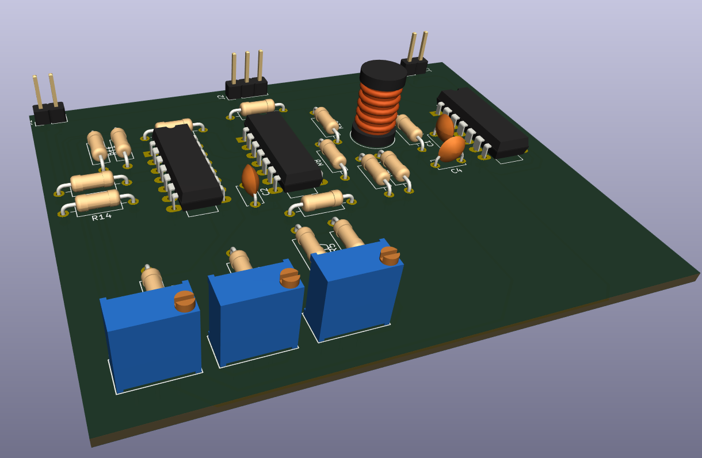

# Series RLC with Analog PID Control


Analog PID controller (op-amp based) designed to eliminate the step-response overshoot of an
underdamped series RLC circuit, documented as an honest engineering logbook: every result is marked as
calculated, simulated, or pending — no invented placeholder data. First of two related course projects;
the second applies the same PID methodology to a buck converter (see
[BUCK_1](../BUCK_1) — an earlier, IC-based adjustable buck, not the PID-controlled version required for
that follow-up project).

- **Plant:** series RLC, $f_0 \approx$ 5 kHz, $\zeta \approx 0.2$ (clearly underdamped by design)
- **Calculated:** L = 10.13 mH, R = 127.32 Ω, C = 100 nF (fixed) — predicted open-loop overshoot ≈52.7%
- **Goal:** classical PID design (root locus / pole placement) to eliminate that overshoot in closed loop

## Directory structure
```
├── design
│   └── design
│       ├── design.kicad_pcb
│       ├── design.kicad_pro
│       ├── design.kicad_sch
│       ├── readme.md
│       └── src
│           └── logFile
├── doc
│   ├── generalconfig.tex
│   ├── PY2.pdf
│   ├── PY2.tex
│   ├── Requirements.md
│   ├── Requirements.pdf
│   ├── sn-jnl.cls
│   └── src
├── LICENSE
├── README.md
├── scripts
│   ├── bode.ipynb
│   ├── design.ipynb
│   └── PID.m
└── sim
    └── RLC.asc

```

- `Design.kicad_sch` / `.kicad_pcb` / `.kicad_pro` — KiCad design
- `Design.step` — 3D model
- `requirements.pdf` — project requirements
- `PY2.pdf` — project report
- `RLC.asc` — LTspice simulation




**Photos of the built board — coming soon**


## Credit
Built as coursework with [DasReyxr](https://github.com/DasReyxr)  and [Kevin Lara](https://github.com/Gyonyu)


## License

MIT — see [LICENSE](LICENSE).


## Template
```
mkdir code design doc scripts sim src
```

```
tree >> README.md
```
